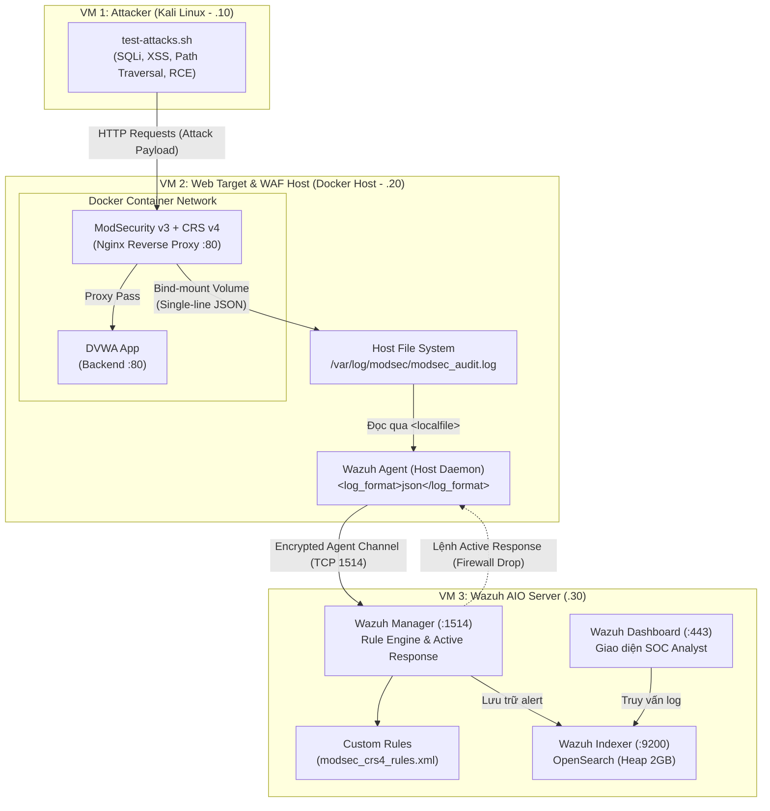

# Tài Liệu Kiến Trúc: Wazuh ModSecurity SIEM Lab

Hệ thống được thiết kế theo mô hình kiến trúc **Multi-Tier / Multi-Node** chuẩn công nghiệp, phục vụ giám sát, phân tích và phản ứng sự cố an toàn thông tin (SOC/SIEM) đối với ứng dụng Web.

---

## 1. Sơ Đồ Kiến Trúc Tổng Thể

---

## 2. Chi Tiết Các Phân Vùng Hệ Thống

### 2.1. VM 1: Attacker (Kali Linux - `192.168.1.10`)
* **Vai trò**: Đóng vai trò kẻ tấn công từ bên ngoài mạng, phát sinh lưu lượng độc hại để kiểm thử khả năng bảo vệ của WAF và khả năng phát hiện của SIEM.
* **Bộ công cụ & kịch bản**:
  * Thực thi file `scripts/test-attacks.sh` với các payload theo chuẩn OWASP Top 10:
    * **SQL Injection (SQLi)**: Thử nghiệm bypass xác thực (`' OR '1'='1`) và trích xuất dữ liệu (`UNION SELECT`).
    * **Cross-Site Scripting (XSS)**: Payload chứa thẻ `<script>` và sự kiện JavaScript độc hại.
    * **Path Traversal / LFI**: Khai thác đọc file hệ thống nhạy cảm (`../../../../etc/passwd`).
    * **Command Injection / RCE**: Thử nghiệm thực thi lệnh shell hệ thống.

---

### 2.2. VM 2: Web Server & WAF Host (Docker Host - `192.168.1.20`)
* **Vai trò**: Nơi vận hành ứng dụng mục tiêu và lớp phòng thủ vòng ngoài (WAF).
* **Kiến trúc phân tầng tại VM 2**:
  1. **Lớp WAF (Nginx + ModSecurity v3 + OWASP CRS v4)**:
     * Chạy trong container Docker, mở cổng `80`.
     * Tiếp nhận mọi request từ client, kiểm tra bộ luật **OWASP Core Rule Set v4**.
     * Nếu vi phạm rule: Trả về mã lỗi **HTTP 403 Forbidden** và ghi log chi tiết.
  2. **Ứng dụng backend (DVWA)**:
     * Chạy độc lập trong cùng mạng bridge Docker (`target-net`).
     * Chỉ tiếp nhận kết nối an toàn đã được Nginx Reverse Proxy lọc qua.
  3. **Cơ chế thu thập Log chuẩn hóa**:
     * **Không dùng Syslog UDP 514 thuần túy** nhằm tránh nguy cơ mất gói, tràn bộ đệm và phân mảnh log JSON nhiều dòng.
     * Container ModSecurity ghi trực tiếp audit log định dạng **Single-line JSON** vào volume mount ngoài host: `/var/log/modsec/modsec_audit.log`.
  4. **Wazuh Agent (Host Daemon)**:
     * Cài đặt trực tiếp trên hệ điều hành của VM 2 (thông qua `scripts/setup-vm2-agent.sh`).
     * Sử dụng directive `<localfile>` với cấu hình `<log_format>json</log_format>` để theo dõi file log theo thời gian thực.
     * Mã hóa và chuyển tiếp log về Wazuh Manager qua cổng **TCP 1514**.
     * Sẵn sàng tiếp nhận lệnh **Active Response** (chặn IP bằng `iptables`) khi có tấn công lặp lại.

---

### 2.3. VM 3: Wazuh AIO Server (`192.168.1.30`)
* **Vai trò**: Trung tâm quản trị, phân tích an ninh mạng tập trung.
* **Các thành phần cốt lõi**:
  1. **Wazuh Manager**:
     * Lắng nghe kết nối an toàn từ Wazuh Agent trên cổng **TCP 1514**.
     * Nạp bộ luật tùy biến `vm3-wazuh-manager/custom-rules/modsec_crs4_rules.xml`.
     * Tự động giải mã các trường JSON: `client_ip`, `http_code`, `messages`, `rule_id`.
     * Phân loại mức cảnh báo:
       * **Level 7**: Mã lỗi 403 bị WAF chặn.
       * **Level 10**: Phát hiện tấn công SQLi, XSS, Path Traversal.
       * **Level 12**: Phát hiện tấn công RCE nghiêm trọng.
       * **Level 14**: Hành vi tấn công dồn dập từ cùng 1 IP trong 60 giây -> Kích hoạt **Active Response**.
  2. **Wazuh Indexer**:
     * Lưu trữ và đánh chỉ mục toàn bộ sự kiện bảo mật.
     * Cấu hình giới hạn Java Heap Memory: `-Xms2g -Xmx2g` nhằm tối ưu hóa tài nguyên cho môi trường lab.
  3. **Wazuh Dashboard**:
     * Web UI trực quan hóa bản đồ tấn công, Top IP vi phạm, Top CRS Rules kích hoạt theo thời gian thực.

---

## 3. Quy Hoạch Mạng & Port Matrix

| Node | Địa Chỉ IP | Dịch Vụ | Port | Giao Thức | Chức Năng |
| :--- | :--- | :--- | :--- | :--- | :--- |
| **VM 1** | `192.168.1.10` | Attack Simulator | N/A | TCP/UDP | Phát sinh traffic kiểm thử |
| **VM 2** | `192.168.1.20` | ModSecurity WAF | `80` | TCP | Cổng tiếp nhận truy cập web công khai |
| | | DVWA Application | `80` (Internal) | TCP | Backend ứng dụng web |
| | | Wazuh Agent | Client | TCP | Đẩy log bảo mật về VM 3 |
| **VM 3** | `192.168.1.30` | Wazuh Manager | `1514` | TCP | Tiếp nhận log từ Agent |
| | | Wazuh API | `55000` | TCP (HTTPS) | Quản trị API và xác thực Agent |
| | | Wazuh Indexer | `9200` | TCP (HTTPS) | Lưu trữ chỉ mục log (OpenSearch) |
| | | Wazuh Dashboard | `443` | TCP (HTTPS) | Giao diện điều khiển Web UI |
